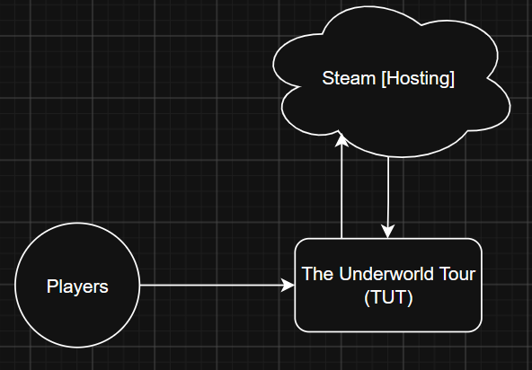

# Design

## Overview
A Godot project

## Architecture
**Context Diagram**: 

**Container Diagram**:

**Component Diagram**:

**Code Diagram**:

## Interfaces
* JSON: Handles song midi map, player data, band member builds

## Data
|Entity|Contents|Implications|
|---|---|---|
|Run            |Current run progress           |Possible Cheating  |
|Band Members   |Each band member's build       |N/A                |
|Encounter      |Enemies, reward                |N/A                |
|Music          |Song, MIDI Map, BPM, Category  |N/A                |

## Deployment
* Engine and version: Godot 4.7
* Source control: The Underworld Tour GitHub
* Build process: Compiled in Godot
* Testing: Each feature is tested by a human, and then the quality of their code is checked by an Agent in the repository
* Distribution: Future distribution handled by Steam

## Open Questions
* How to ready game for Steam deployment?
* How to optimize gameplay for minimal latency?

## Deferred Decisions
* How to do data storage relating to differing maps in the future?
* Will enemies be able to hold items?